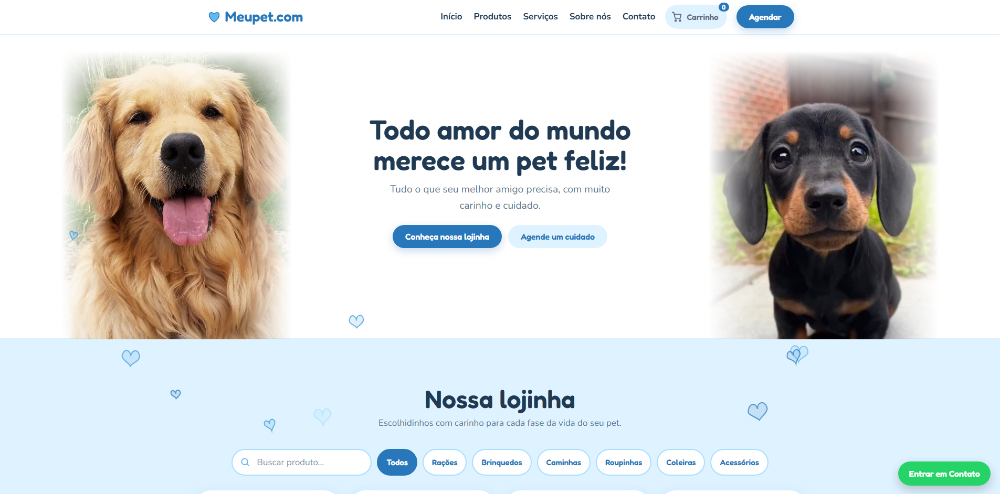

# 🐾 ⎯ Meupet

### Todo amor do mundo merece um pet feliz! 💙

O **Meupet** é um projeto de plataforma de petshop desenvolvido para proporcionar uma experiência moderna, intuitiva e encantadora para tutores de animais. Com uma identidade visual delicada em tons de azul e branco, a plataforma apresenta produtos, serviços e cuidados especiais para os pets, combinando tecnologia, carinho e uma experiência digital divertida.

## 🌐 Demonstração

🔗 **Acesse o projeto online:** https://shwnzzzz.github.io/Meupet-ProjectShw/

## ✨ Funcionalidades

- 🐾 Página inicial com apresentação do petshop.
- 🐶 Mascotes ilustrados, incluindo Golden Retriever, Shih-tzu e Dachshund.
- 🛍️ Catálogo de produtos para animais.
- 🦴 Categorias de rações, brinquedos, roupinhas e acessórios.
- 🛁 Apresentação de serviços de banho e tosa.
- 📅 Agendamento de serviços para pets.
- 🛒 Carrinho de compras interativo.
- ⭐ Seção de avaliações e depoimentos de clientes.
- 📸 Galeria de fotos dos animais.
- 💙 Animações de corações e elementos flutuantes.
- 🐕 Efeitos interativos com os mascotes.
- 📩 Formulário de inscrição para newsletter.
- 📱 Layout responsivo para diferentes dispositivos.

## 🎨 Identidade Visual

O projeto utiliza uma identidade visual delicada, divertida e acolhedora, inspirada no carinho entre pessoas e animais, transmitindo amor, cuidado e felicidade.

- **Cores predominantes:** Azul-bebê, azul-claro e branco.
- **Estilo:** Fofo, moderno e minimalista.
- **Design:** Interface delicada com corações, patinhas e ilustrações de animais.
- **Animações:** Corações flutuantes, explosões de partículas e efeitos de transição.
- **Experiência:** Navegação intuitiva, dinâmica e interativa.

## 🛠️ Tecnologias utilizadas

- HTML5
- CSS3
- JavaScript
- AOS.js (Animate On Scroll)
- GSAP
- Font Awesome / Lucide Icons
- Bibliotecas externas via CDN

## 🎯 Objetivo do projeto

O Meupet foi desenvolvido como projeto de portfólio, com o objetivo de colocar em prática conhecimentos de desenvolvimento web, programação JavaScript, criação de interfaces interativas, animações e princípios de UI/UX Design. O projeto busca demonstrar como uma plataforma de petshop pode oferecer uma experiência digital atrativa, acolhedora e funcional, valorizando o cuidado com os animais e a conexão entre tecnologia e carinho.

## 👨‍💻 Desenvolvedor

**ShwDevs** Desenvolvimento de Software | UI/UX Design | Desenvolvimento Mobile

---

  Desenvolvido com 💙 por <strong>ShwDevs</strong>
   
  <strong>🐾 Meupet — Amor, cuidado e felicidade em cada patinha.</strong>

